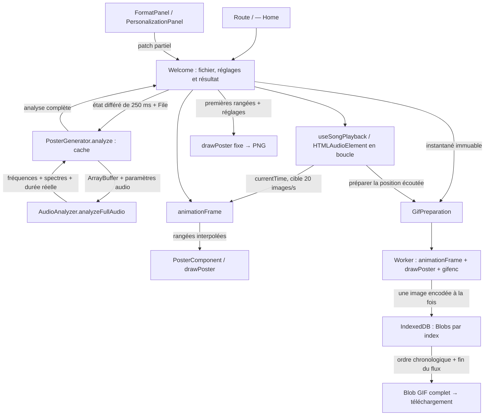

# 02 — Architecture

## Socle technique

Le projet est une application React/TypeScript construite avec React Router en mode framework et Vite. Le rendu serveur est activé (`ssr: true`), mais l’import audio, l’analyse, la lecture, le dessin et l’encodage GIF s’exécutent dans le navigateur. Il n’existe pas de backend métier, de base de données serveur, de route API ni d’authentification. IndexedDB sert uniquement de stockage temporaire local pour les images GIF encodées.

| Élément                                          | Version du verrou npm inspecté | Rôle                                                                      |
| ------------------------------------------------ | ------------------------------ | ------------------------------------------------------------------------- |
| React / React DOM                                | 19.2.6                         | Interface et état des composants.                                         |
| React Router                                     | 7.12.0                         | Routage, rendu serveur, génération de types et serveur de production.     |
| Vite                                             | 7.3.3                          | Serveur de développement, build et empaquetage du worker GIF.             |
| TypeScript                                       | 5.9.3                          | Typage strict ; alias `~/*` vers `app/*`.                                 |
| Tailwind CSS                                     | 4.3.0                          | Styles utilitaires via le plugin Vite.                                    |
| Prettier                                         | 3.8.3                          | Formatage ; la commande `lint` vérifie ce formatage.                      |
| Lucide React                                     | Déclaration `^0.575.0`         | Icônes de la barre d’outils.                                              |
| gifenc                                           | 1.0.3                          | Quantification des couleurs, indexation et encodage GIF image par image.  |
| HTMLAudioElement / Web Audio API                 | API du navigateur              | Lecture audible et analyse hors ligne indépendante.                       |
| Canvas 2D / OffscreenCanvas / Worker / IndexedDB | API du navigateur              | Aperçu, rendu GIF hors du thread principal et stockage temporaire encodé. |

Les versions résolues du verrou peuvent différer des plages de `package.json`. Emotion et `isbot` sont déclarés comme dépendances, sans import dans le code applicatif inspecté.

Sources : [package.json](../../package.json), [package-lock.json](../../package-lock.json), [configuration Vite](../../vite.config.ts), [TypeScript](../../tsconfig.json), [React Router](../../react-router.config.ts).

## Carte du dépôt

| Fichier / dossier                                               | Responsabilité                                                                                             |
| --------------------------------------------------------------- | ---------------------------------------------------------------------------------------------------------- |
| `app/root.tsx`                                                  | Document HTML, police Inter, styles globaux, outlet et page d’erreur de route.                             |
| `app/routes.ts`, `app/routes/home.tsx`                          | Unique route `/`, métadonnées et montage de `Welcome`.                                                     |
| `app/welcome/welcome.tsx`                                       | État central, import, analyse, mode d’affichage, dimensions, lecteur, exports et disposition responsive.   |
| `app/welcome/useSongPlayback.ts`                                | Cycle de vie du fichier audio, lecture/pause, position, volume, erreurs de lecture et horloge d’animation. |
| `app/welcome/downloadBlob.ts`                                   | Téléchargement par URL d’objet, puis révocation différée.                                                  |
| `app/welcome/FormatPanel.tsx`                                   | Choix du format et conversions des dimensions saisies.                                                     |
| `app/welcome/PersonalizationPanel.tsx`                          | Réglages avancés, sélection des styles et presets, informations du fichier.                                |
| `app/welcome/posterEditorState.ts`                              | Format partagé et conservation des réglages propres à chaque style.                                        |
| `app/welcome/welcome.types.ts`, `welcome.constants.ts`          | Contrats d’édition, valeurs initiales, limites, formats et presets.                                        |
| `app/renderer/PosterGenerator.ts`                               | Lecture du fichier, cache des analyses complètes et API historique limitant les lignes fixes.              |
| `app/renderer/AudioAnalyzer.ts`                                 | Décodage, sélection du premier canal et prélèvements spectraux hors ligne sur la durée réelle.             |
| `app/renderer/animation.ts`                                     | Interpolation cyclique, échelle globale et borne de relief sur le morceau entier.                          |
| `app/renderer/PosterRenderer.ts`                                | Fonction drawPoster partagée entre aperçu, PNG et GIF ; filtrage, axes et sélection du style.              |
| `app/renderer/JoyDivisionRenderer.ts`                           | Tracé Joy Division, avec géométrie stabilisée pour l’animation.                                            |
| `app/renderer/PosterComponent.tsx`                              | Adaptateur React du rendu partagé vers le canevas d’aperçu.                                                |
| `app/animation/GifPreparation.ts`                               | Session GIF, commandes du worker, promesse d’export et durée de vie indépendante de l’éditeur.             |
| `app/animation/gif.worker.ts`                                   | Rendu OffscreenCanvas, encodage progressif, stockage IndexedDB et assemblage chronologique.                |
| `app/animation/gifTimeline.ts`, `gifMessages.ts`, `gifenc.d.ts` | Cadence et délais GIF, garde de dimensions, protocole du worker et types de l’encodeur.                    |
| `app/notes/Notes.ts`                                            | Table statique des notes de C0 à B8 et fréquences associées.                                               |
| `app/app.css`                                                   | Tailwind, police globale et règles liées au thème sombre.                                                  |
| `public/favicon.ico`, `app/welcome/logo.png`                    | Identité graphique existante.                                                                              |
| `song.mp3`                                                      | Fichier audio présent à la racine ; aucun chargement automatique par l’application.                        |

AudioAnalysisParameters.tsx, RendererParameters.tsx et FileDetails.tsx restent sans import dans le parcours actif. `app/welcome/test.html` est une expérimentation Canvas autonome, sans route ni branchement dans l’éditeur. Les dossiers `build/` et `.react-router/` sont générés et ignorés par Git.

## Flux principal



## État et contrats

Welcome possède l’état d’édition via [posterEditorState](../../app/welcome/posterEditorState.ts) : style sélectionné, format commun et réglages propres à chaque style. Le PosterState aplati est reconstruit pour les panneaux et le rendu. Le mode fixe ou animé ne crée pas une seconde copie des personnalisations.

L’éditeur conserve séparément le fichier, les réglages différés, le résultat rendu avec ses paramètres et son style, la visibilité des panneaux, les erreurs, l’inspection temporelle et la progression d’export. Un compteur ignore les anciens résultats sans annuler leurs calculs. Pendant un recalcul, la lecture et l’ancien aperçu continuent ; le résultat valide est ensuite affiché à la position actuelle. Un échec d’analyse invalide le résultat et affiche une erreur.

Les contrats de traitement sont les suivants :

```ts
// AudioAnalyzer.ts : analyse complète réutilisable.
type AnalyzedAudioData = {
    xAxis: number[];
    duration: number; // Durée décodée exacte en secondes.
    frequencyData: number[][];
};

// PosterGenerator.ts : contrat historique pour le poster fixe.
type GeneratedPosterInfos = {
    xAxis: number[];
    series: number[][];
};

// PosterRenderer.ts : rangée fournie au dessin partagé.
type YAxisData = {
    timestamp: number; // Index en fixe ; décalage relatif en secondes en animé.
    frequencyData: number[];
};
```

Les amplitudes analysées sont comprises entre 0 et 255 ; l’interpolation animée produit aussi des valeurs fractionnaires. Les temps de prélèvement sont reconstitués avec `index × durationBetweenLines` et la durée exacte borne le dernier intervalle. Le poster fixe sélectionne les premières lignes ; animationFrame évalue toute la timeline en boucle.

PosterGenerator conserve au plus quatre promesses d’analyse par fichier dans une WeakMap, selon FFT, lissage, décibels et intervalle. Apparence, format et nombre de lignes réutilisent les spectres. Les échecs sont retirés du cache pour permettre un nouvel essai. L’analyseur ferme son contexte audio dans un bloc finally.

useSongPlayback gère une URL d’objet pour le fichier courant et un élément `<audio loop>`. Cet élément est l’horloge audible ; requestAnimationFrame lit son currentTime au plus une fois par tranche de 50 ms. L’animation et l’export ne pilotent pas sa progression. La pause conserve la position audio et le temps de la dernière image affichée : elle ne recopie pas currentTime dans l’état de rendu, et les callbacks d’animation restants ignorent un élément audio déjà en pause. Le mode de vue est indépendant de isPlaying : une pause conserve la vue animée figée ; Still poster rétablit explicitement la vue fixe. Un changement de fichier ferme l’ancienne URL et repart au début en pause, en vue fixe.

PosterComponent dessine via drawPoster dans un effet de mise en page. Le PNG utilise aussi cette fonction, mais dans un canevas fixe séparé de l’aperçu animé. Le GIF partage le même rendu dans un OffscreenCanvas du worker. globalAnalysisScale calcule sur tous les spectres le maximum d’amplitude et la borne du relief pondéré par l’enveloppe Joy Division. L’aperçu, le PNG et le worker emploient ces mêmes valeurs stables ; la marge supérieure ne dépend pas de l’image courante.

## Préparation et isolation du GIF

[GifPreparation](../../app/animation/GifPreparation.ts) reçoit un instantané contenant analyse complète, paramètres, style et dimensions. postMessage le copie vers un worker propre à la session. prepare(timeSeconds) demande les images correspondant à l’écoute ; export(onProgress) complète celles qui manquent sans solliciter le lecteur. La cadence et le dernier délai viennent de [gifTimeline](../../app/animation/gifTimeline.ts).

Le worker dessine et encode une image à la fois. Les fragments GIF, avec palettes adaptées à chaque image, sont stockés en Blobs dans une base IndexedDB temporaire, indexés par numéro d’image. La première image porte l’en-tête et la répétition infinie ; les autres ont une palette locale. L’export relit les fragments dans l’ordre et ajoute le marqueur de fin avant de fournir un Blob image/gif. Il ne conserve pas l’ensemble des images RGBA.

Une modification du fichier ou du rendu crée une nouvelle préparation. dispose() diffère la destruction d’une session dont l’export est actif : celui-ci conserve donc le morceau et tous les réglages de lancement. cancel() rejette l’export avec AbortError et conserve les images déjà préparées tant que la session reste courante. Une seule promesse d’export est active dans l’éditeur.

La destruction du worker demande la suppression de sa base temporaire ; pagehide ferme aussi les sessions. Un arrêt forcé du navigateur peut laisser des données temporaires abandonnées. Les quotas IndexedDB, les capacités OffscreenCanvas et la gestion mémoire du Blob final restent des contraintes du navigateur, détaillées dans les [limites](05-limites-actuelles.md).
