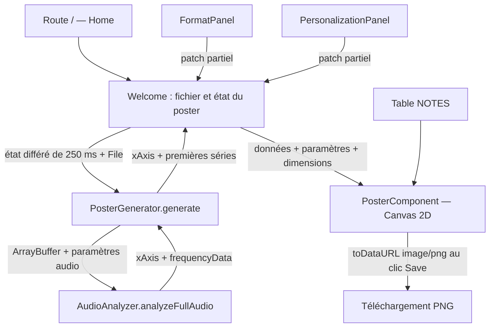

# 02 — Architecture

## Socle technique

Le projet est une application React/TypeScript construite avec React Router en mode framework et Vite. Le rendu serveur est activé (`ssr: true`), mais l’import audio, l’analyse et le dessin s’exécutent dans le navigateur. Il n’existe pas de backend métier, de base de données, de route API ni d’authentification dans le code inspecté.

| Élément                   | Version du verrou npm inspecté | Rôle                                                                  |
| ------------------------- | ------------------------------ | --------------------------------------------------------------------- |
| React / React DOM         | 19.2.6                         | Interface et état des composants.                                     |
| React Router              | 7.12.0                         | Routage, rendu serveur, génération de types et serveur de production. |
| Vite                      | 7.3.3                          | Serveur de développement et build.                                    |
| TypeScript                | 5.9.3                          | Typage strict ; alias `~/*` vers `app/*`.                             |
| Tailwind CSS              | 4.3.0                          | Styles utilitaires via le plugin Vite.                                |
| Prettier                  | 3.8.3                          | Formatage ; la commande `lint` vérifie ce formatage.                  |
| Lucide React              | Déclaration `^0.575.0`         | Icônes de la barre d’outils.                                          |
| Web Audio API / Canvas 2D | API du navigateur              | Analyse du son et dessin du poster.                                   |

Les versions résolues du verrou peuvent différer des plages de `package.json`. Emotion et `isbot` sont déclarés comme dépendances, sans import dans le code applicatif inspecté.

Sources : [package.json](../../package.json), [package-lock.json](../../package-lock.json), [configuration Vite](../../vite.config.ts), [TypeScript](../../tsconfig.json), [React Router](../../react-router.config.ts).

## Carte du dépôt

| Fichier / dossier                            | Responsabilité                                                                      |
| -------------------------------------------- | ----------------------------------------------------------------------------------- |
| `app/root.tsx`                               | Document HTML, police Inter, styles globaux, outlet et page d’erreur de route.      |
| `app/routes.ts`, `app/routes/home.tsx`       | Unique route `/`, métadonnées et montage de `Welcome`.                              |
| `app/welcome/welcome.tsx`                    | État central, import, orchestration des calculs, dimensions, export et disposition. |
| `app/welcome/FormatPanel.tsx`                | Choix du format et conversions des dimensions saisies.                              |
| `app/welcome/PersonalizationPanel.tsx`       | Réglages avancés, sélection des presets et informations du fichier.                 |
| `app/welcome/welcome.types.ts`               | Types `PosterState` et `PosterPreset`.                                              |
| `app/welcome/welcome.constants.ts`           | Valeurs initiales, limites, formats et presets.                                     |
| `app/renderer/PosterGenerator.ts`            | Lecture du fichier, appel à l’analyseur et limitation du nombre de lignes.          |
| `app/renderer/AudioAnalyzer.ts`              | Décodage, sélection du premier canal et prélèvements spectraux hors ligne.          |
| `app/renderer/PosterComponent.tsx`           | Filtrage fréquentiel, axes, courbes et canevas de prévisualisation/export.          |
| `app/notes/Notes.ts`                         | Table statique des notes de C0 à B8 et fréquences associées.                        |
| `app/app.css`                                | Tailwind, police globale et règles liées au thème sombre.                           |
| `public/favicon.ico`, `app/welcome/logo.png` | Identité graphique existante.                                                       |
| `song.mp3`                                   | Fichier audio présent à la racine ; aucun chargement automatique par l’application. |

`AudioAnalysisParameters.tsx`, `RendererParameters.tsx` et `FileDetails.tsx` sont des composants sans import dans le parcours actif. `app/welcome/test.html` est une expérimentation Canvas autonome, sans route ni branchement dans l’éditeur. Les dossiers `build/` et `.react-router/` sont générés et ignorés par Git.

## Flux principal



## État et contrats

`Welcome` possède le fichier sélectionné, deux indicateurs de génération, la visibilité des panneaux, le `PosterState` courant et sa copie différée. Les panneaux remontent des `Partial<PosterState>` fusionnés avec l’état courant.

Les contrats de traitement sont les suivants :

```ts
// AudioAnalyzer.ts : sortie de l’analyse complète
type AnalyzedAudioData = {
    xAxis: number[];
    frequencyData: number[][];
};

// PosterGenerator.ts : sortie après limitation des lignes
type GeneratedPosterInfos = {
    xAxis: number[];
    series: number[][];
};

// Données préparées par Welcome pour PosterComponent
type YAxisData = {
    timestamp: number; // Index de ligne, pas un temps mesuré en secondes.
    frequencyData: number[];
};
```

Les amplitudes stockées sont des nombres entre 0 et 255. Les temps physiques ne sont pas stockés dans la sortie de l’analyseur : le rendu reconstitue une étiquette avec `index × durationBetweenLines`.

Un compteur de génération évite qu’un résultat d’une ancienne demande remplace celui d’une demande plus récente. Ce mécanisme ne stoppe pas le calcul précédent et ne libère pas ses contextes audio. L’état d’erreur n’est pas modélisé séparément.

Le même objet `PosterState` regroupe analyse audio, style, format et métadonnées de preset. Il est passé aux fonctions qui n’en utilisent qu’une partie. Cette organisation explique pourquoi une modification de couleur ou d’unité de saisie relance aussi le décodage audio.
